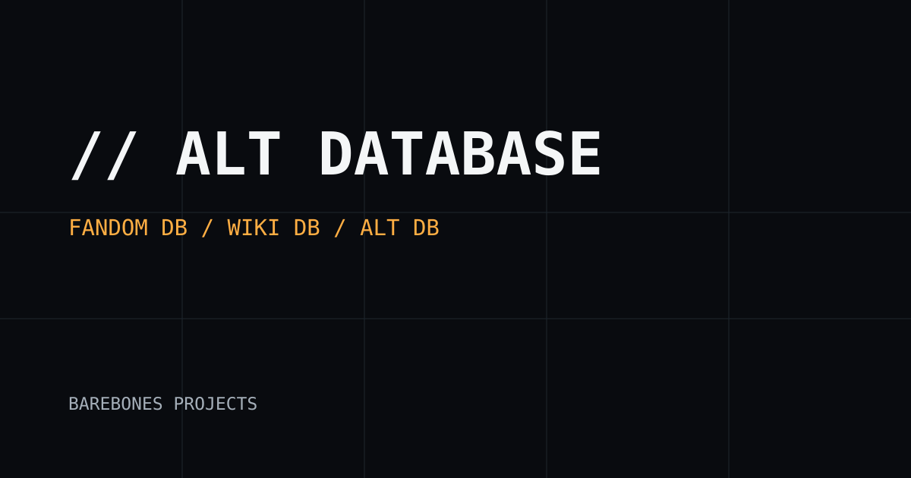

# // ALT DATABASE WEB

Standalone **public website interface** for the ALT Multiverse, separate from the authoritative [BareBones-Projects/ALT-Database-db](https://github.com/BareBones-Projects/ALT-Database-db).

**BareBones Projects, Designed by: Justin Levesque-Welsch.**

## Repository boundaries

This project owns the public website shell, styling and approved deployable static assets. It **does not own** database-backed portals, canonical records, upload storage or backend authentication.

The following belong in the **ALT-Database-db** repository, not here:

- `/fandom-db/` — Fandom entities, characters, factions and species.
- `/wiki-db/` — Encyclopedia and public wiki data.
- `/alt-db/` — Planetary, navigation, location and canonical ALT data.

Their frontend route files and corresponding portal-only logic have been removed from this website repository. Links are documentation of **ownership**, not deployed routes.

## Local development

Run `python3 -m http.server 8080` from the repository root, then visit `http://localhost:8080/`. Run `node --test tests/*.test.mjs` with Node 20+.

## Deployment

GitHub Pages deploys the allowlisted website shell from `main` through [pages.yml](.github/workflows/pages.yml). Configure repository Settings → Pages → Source: GitHub Actions. CI checks the site structure and enforces separation from the database portals.

## Assets

Approved public images, files, and preview media belong in `assets/`. See [assets/README.md](assets/README.md). Persistent browser uploads require a separately authenticated backend and object storage.

## Security

No credentials, SQLite runtime files, backend, database portals or draft/private records belong in this public repository. See [SECURITY.md](SECURITY.md).

MIT licensed. © 2026 BareBones Projects.